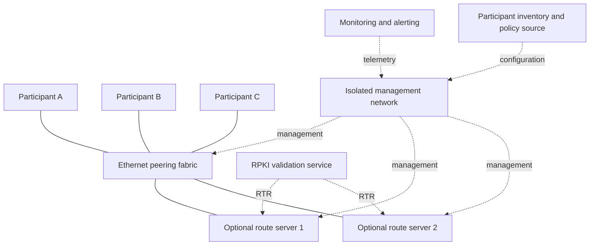

# µIX reference architecture v0.1

Working draft. SPDX-License-Identifier: CC-BY-4.0

This informative architecture implements the design intent of [specification v0.1](../specification/v0.1.md) and [deployment profiles](../profiles/README.md). Normative requirements remain in those documents. It is not a deployed topology.

## Logical architecture

Dashed lines are logical service or management relationships, not physical cabling. Route servers do not forward participant traffic.

## Components and boundaries

| Component | Responsibility | Candidate implementation (not mandatory) |
|---|---|---|
| Peering fabric | Dedicated Ethernet LAN, port controls, consistent MTU | Managed Ethernet switches |
| Routing services | Optional multilateral BGP, import/export policy | BIRD or FRRouting |
| Origin validation | Validated ROA data and documented stale-cache handling | Routinator or equivalent |
| Management | Restricted administrative access, configuration and recovery | Dedicated VLAN/network, VPN, out-of-band access |
| Observability | Port, session, prefix and service health; independent alerts | Prometheus/Grafana or equivalent |
| Participant management | Authorized ASN, contacts, ports, addressing and policy | IXP Manager or lightweight inventory |
| Recovery | Protected configuration backups and tested restoration | Encrypted independent backup storage |

## Data plane

Use a dedicated dual-stack peering LAN per exchange domain. Document addressing, MTU, MAC limits, permitted Ethernet protocols and participant attachment. Permit required IPv6 neighbor discovery and IPv4 ARP while preventing unauthorized DHCP, router advertisements and other disruptive control traffic. Validate protections against actual switch capabilities. No default transit gateway is implied. Use legitimately assigned resources for production; documentation addresses and synthetic ASNs belong only in isolated examples.

## Routing and policy plane

Bilateral BGP remains independent of route servers. Optional route servers preserve the participant next hop and implement the specification's conditional requirements. Generate participant-specific policy from authorized inventory, validated routing data and explicit exceptions. Validate configuration before activation and retain rollback artifacts. Monitor RPKI freshness and document failure behavior; redundant validators should avoid shared dependencies where feasible.

## Management and recovery

Keep administrative interfaces inaccessible from participant ports. Separate credentials and privileges by role. Collect telemetry without exposing private participant data; document retention and publication policy. Maintain independent alert delivery, protected backups and tested restoration. Prefer out-of-band access where feasible.

## Profile mapping

Nano permits a single switch and no route server. Micro requires two route-server instances in independent host failure domains; redundant switching is recommended. Regional requires redundant switching paths and at least two independently hosted route servers. Document power, host, switch, uplink and management failure domains; multiple VMs on one host do not establish host redundancy.

## Distributed operation

Each exchange is independently administered and can operate without a central µIX service. Separate exchange domains should normally retain separate peering LANs and routing policies. Optional inter-site transport must explicitly document ownership, MTU, loop prevention, capacity, failure propagation and security boundaries. Do not silently bridge independent exchanges or redistribute participant routes. A federated control plane or common membership registry is not required.

## Implementation workflow

Select a profile; record local facility and resource constraints; generate inventory and policy; validate in an isolated lab; deploy management and monitoring; activate fabric and optional routing services; test recovery and applicable conformance requirements; then onboard consenting participants.

The existing [planning architecture](../docs/architecture.md) remains historical context. SIR1-specific design, hardware selection and production acceptance are separate work. No interoperability or production validation is claimed.
