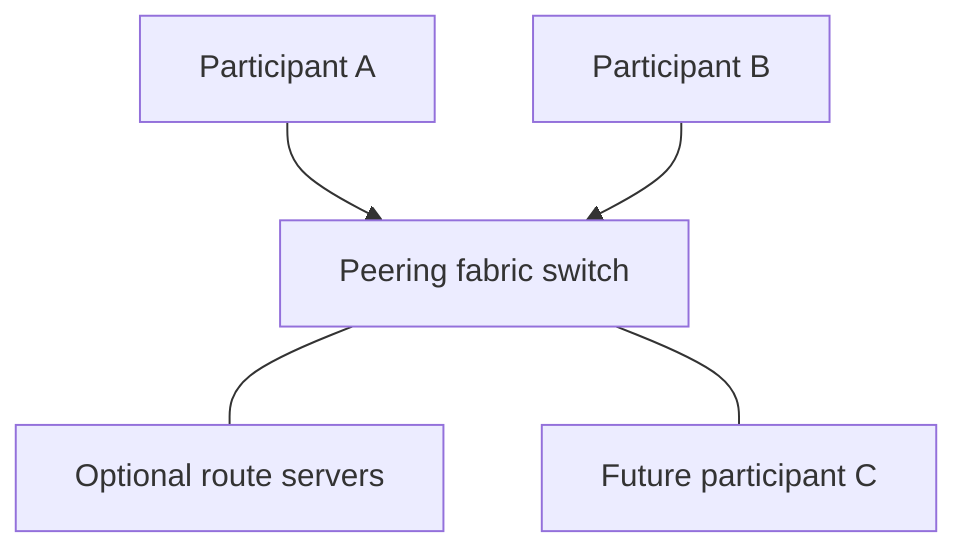

# Reference architecture (planning)

> Conceptual design only. Nothing in this document describes a deployed µIX network.

## Separation of planes

1. **Peering data plane:** dedicated Layer 2 switching fabric carrying participant-to-participant traffic, with no requirement to use Ploos as transit.
2. **Routing services:** optional independent route servers for multilateral BGP sessions. Route servers must not become an IP transit service.
3. **Management plane:** isolated management network and out-of-band access where feasible. Participant ports must not expose switch management interfaces.
4. **Observability:** port and service health, route-server session state, traffic statistics with an explicitly documented retention and privacy policy.

## Phase-one topology

The virtual lab should validate this model before hardware or addressing decisions.

## Candidate components (not selected)

- Managed Ethernet switch with VLAN isolation and appropriate port-speed options
- BIRD or FRRouting for route-server experiments
- RPKI validator and automated prefix/AS-path filtering
- Prometheus/Grafana or equivalent metrics stack
- IXP Manager or a lightweight inventory/onboarding workflow

## Decisions required before production

- Suitable carrier connectivity, physical cross-connects and local demand
- Addressing for the peering LAN; IPv4/IPv6 allocation and route-server ASN as appropriate
- Redundancy and failure domains; power, cooling, switching and management access
- Member eligibility, route-server policy, abuse contacts and change control
- Transparent cost recovery and contractual/operational obligations
- Whether PeeringDB registration is appropriate once real facilities/services exist

Do not commit real router credentials, secrets, customer circuits, non-public addressing or production configurations to this repository.
