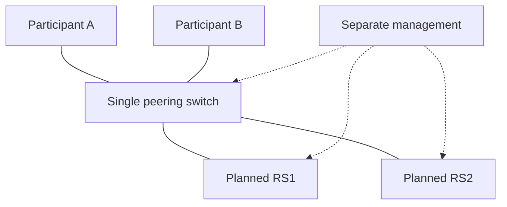

# YIX-SIR1 — Sirdal, Norway

Status: planned physical reference implementation; not operational.
SPDX-License-Identifier: CC-BY-4.0

SIR1 is intended to validate the µIX framework in a small regional facility. Ploos AS is the proposed operator and Ploos Datacenter the proposed facility. Neither is a required supplier for other implementations.

## Implementation baseline

| Item | Proposed value |
|---|---|
| Identifier | YIX-SIR1 |
| Specification | v0.1 working draft |
| Initial target | Nano |
| Expansion target | Micro |
| Fabric | One managed 10GbE-capable switch initially |
| Participant ports | 1/10GbE subject to compatibility |
| Route servers | Two independently hosted instances planned, subject to resources |
| Addressing | Dual stack; legitimate production allocations pending |
| Management | Separate restricted network |
| Facility | Shared rack space; site, power and fibre unconfirmed |

The existing [SIR1 technical design](../../docs/yix-sir1.md) remains the local design record. Its two-switch diagram describes a future topology, not initial redundancy. Nano permits optional route servers, but SIR1 plans two; if activated, all conditional route-server requirements apply. Micro is a future assessed profile, not an automatic upgrade.

## Initial topology

The switch is a single point of failure. Route servers are control-plane services only. Host independence, power dependencies and management access require verification.

## Readiness gates

| Gate | Required evidence | Status |
|---|---|---|
| Facility | Site, rack, power, cooling and physical access | Pending |
| Connectivity | Carrier offers, fibre paths and cross-connect feasibility | Pending |
| Demand | At least two independent prospective networks; consent before activation | Pending |
| Resources | Verified ASN and peering LAN allocation as applicable | Pending |
| Policy | Approved neutral access terms and participant agreements | Pending |
| Technical | Fabric, dual stack, filtering, monitoring and recovery tests | Pending |
| Conformance | Evidence against baseline and selected profile | Pending |
| Launch | Approved operational contacts, support terms and verified public status | Pending |

## Feedback into the framework

Record each test against the specification requirement ID and profile ID, with date, configuration revision, expected result, observed result and evidence reference. Classify findings as local constraint, implementation defect, specification ambiguity or proposed general improvement. Submit general changes through framework review rather than silently changing normative requirements to match SIR1.

Publish sanitized findings and reusable configurations; exclude credentials, participant-sensitive information and unapproved production details. A successful local test does not establish universal interoperability.

## Related documents

- [Specification](../../specification/v0.1.md)
- [Profiles](../../profiles/README.md)
- [Reference architecture](../../architecture/reference-v0.1.md)
- [Local technical design](../../docs/yix-sir1.md)
- [Operations runbook](../../docs/operations-security-runbook.md)

No hardware purchase, resource allocation, participant commitment, completed test or production conformance is asserted.
